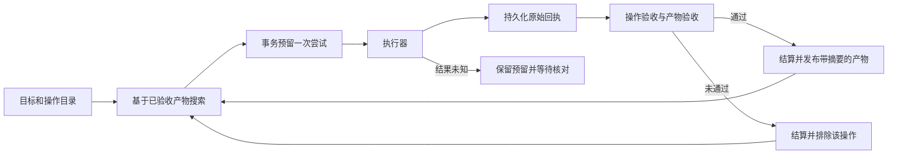

# 产物执行内核

v1 在执行前把请求编译成一张任务图，并给每个任务分配执行者。新内核接受另一种任务合同：指定要得到的产物、哪些输入已经具备、怎样验收，以及最多可以花多少。宿主提供可用操作，每种操作声明输入、单一输出、执行器、局部验收和整数报价。同一个输出可以有多个生产者。一次模型调用与“先抽取两份数据再合成”因此可以竞争同一项交付。



### 规划的保证

规划状态是已经可用的产物集合。一个操作需要的输入必须全部齐备；生产同一产物的多个操作构成候选路径。反向裁剪保留可能影响目标的操作，正向闭包给出可达性与一条可执行路径。接下来的有界搜索使用“每个缺失目标的最低直接生产报价之和”作下界。共享前置产物只需生产一次。

`optimal=true` 表示在当前报价、当前可用产物以及所选操作均成功的条件下，完整计划费用最低。搜索额度用尽时，若已有预算内可行路径，返回该路径并标记 `optimal=false`；否则返回 `search_limit`。调用方可以区分搜索额度耗尽、预算不足和目标不可达。实际执行一次只提交下一项操作，拿到真实验收结果和计费回执后再规划。每个运行目前只有一个在途操作。v1 的并发调度与 P95 预测仍用于原工作流。

### 执行、验收与恢复

每个终产物、每个有多个生产者的中间产物都要声明独立验收器。生产者通过自己的局部检查后，还必须通过这一公共条件。预填的初始产物如有关联规则，也要先验收。内置 `json_object` 检查结构和必需字段；内容正确性需要与任务相符的验收器。

SQLite 事务把尝试 ID、预留和输入摘要写在派发之前。执行器返回后，内核先持久化原始 JSON 回执，再在一次事务中完成结算和合格产物的发布。重启时，已记录的结果直接进入验收。仅记录了派发而结果未知时，预算保留给原尝试，调用方可凭供应商记录显式核对。这样可以恢复本地状态；外部系统的副作用仍取决于其幂等和回执能力。

可在本地这样检查或恢复一次运行：

```sh
python -m costweave show first-handoff
python -m costweave resume first-handoff
python -m costweave reconcile RUN_ID ATTEMPT_ID receipt.json
```

核对完成的结果使用 `{"outcome":"returned","value":{"owner":"Lin","hours":4},"actual_units":1}`，仍须通过原验收器。经外部记录确认失败时使用 `{"outcome":"confirmed_failed","actual_units":1}`。缺少实际费用时按预留报价结算。同一编号重复提交相同任务复用已完成的结果，重复提交不同内容会被拒绝。

### 接入与迁移

| 入口 | 用法 |
|---|---|
| CLI | `python -m costweave plan/run JOB` 接受完整作业；在命令末尾添加 `--catalog CATALOG` 可把目标请求编译成冻结的作业。已安装的包也提供 `costweave` 命令。全局 `--db FILE` 放在子命令之前。 |
| 网页 | 启动本地服务，从首页进入“产物运行台”。载入交接单示例，使用固定编号提交，再查看已验收输出、剩余额度和事件记录。 |
| HTTP | 本地服务用 `POST /api/v2/runs` 接受完整作业 JSON，`Idempotency-Key` 指定运行编号。通过 `GET /api/v2/runs/{id}` 或 `/events` 读取状态和事件；`POST /api/v2/runs/{id}/resume` 使用空对象；`/reconcile` 接受 `attempt_id` 和 `receipt`。沿用会话令牌、项目权限和本地数据驻留约束。 |
| Python | `Runtime(KernelStore(path), registry).submit(run_id, job)`。从 `costweave.kernel` 下的 `runtime`、`store`、`contracts`、`ports` 模块导入相应类型。 |
| 原有调用方 | 原来的 `costweave --port ...`、自由文本表单和 `/api/v1` 请求依旧可用。两套运行记录有各自的数据库和合同。迁移时先指定一个可独立验收的交付目标，再登记旧流程的生产操作。 |

默认 CLI 账本位于用户目录的 `.costweave/artifact-runtime.sqlite3`，可用 `COSTWEAVE_ARTIFACT_DB` 更换。HTTP 按项目将新账本放在原运行数据库旁的 `.artifacts` 目录；备份新运行时须包含对应的 SQLite 文件。默认 HTTP 界面只注册本地操作。

宿主可通过 `ports.default_registry()` 注册受信任的执行器和纯验收函数，再交给 Python 运行时。命令行接受 `--registry NAME`，通过已安装的 `costweave.registries` 包入口加载该注册表。模型路线用 `provider_port.register_model_route` 绑定到原有实验适配器、项目、运行及美元账本。任务配置只提供提示词和已声明的输入。所有竞争路线要使用同一单位换算和固定版本的执行器、验收器名称。已核实的单次计费回执支持按实际金额向上折算；仅有用量估算时，内核按报价结算。供应商回执保存在原账本，整数单位账本用于任务内准入。

### 同任务对照

在仓库根目录执行 `python -m scripts.compare_artifact_runtime`。六个本地发票场景共用输入、操作报价和独立终验。旧版联合搜索分别在直接交付和固定分解两种拓扑内选路线，验收失败后也可以在原拓扑内重选。新内核可在运行中改变生产路径。统计包含失败尝试和未完成的任务。

| 执行策略 | 最终通过 | 总测试费用单位 |
|---|---:|---:|
| v1 直接交付拓扑 | 3/6 | 11 |
| v1 固定分解拓扑 | 5/6 | 18 |
| 产物执行内核 | 5/6 | 18 |

摘要正确时，新内核花 1 单位完成，固定分解花 5。摘要过期时，新内核花 6，其中 1 单位用于失败的快捷路线；固定分解花 5。这组数据展示了运行中切换拓扑的价值和试错代价。它使用确定性执行器，尚未测量真实模型的节省金额、延迟或总体质量提升。
