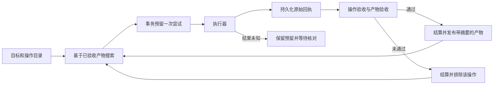

# 产物执行内核

v1 在执行前把请求编译成一张任务图，并给每个任务分配执行者。新内核接受另一种任务合同：指定要得到的产物、哪些输入已经具备、怎样验收，以及最多可以花多少。宿主提供可用操作，每种操作声明输入、单一输出、执行器、局部验收和整数报价。同一个输出可以有多个生产者。一次模型调用与“先抽取两份数据再合成”因此可以竞争同一项交付。



### 规划的保证

规划状态是已经可用的产物集合。一个操作需要的输入必须全部齐备；生产同一产物的多个操作构成候选路径。反向裁剪保留可能影响目标的操作，正向闭包给出可达性与一条可执行路径。接下来的有界搜索使用“每个缺失目标的最低直接生产报价之和”作下界。共享前置产物只需生产一次。

`optimal=true` 表示在当前报价、当前可用产物以及所选操作均成功的条件下，完整计划费用最低。搜索额度用尽时，若已有预算内可行路径，返回该路径并标记 `optimal=false`；否则返回 `search_limit`。调用方可以区分搜索额度耗尽、预算不足和目标不可达。实际执行一次只提交下一项操作，拿到真实验收结果和计费回执后再规划。每个运行目前只有一个在途操作。v1 的并发调度与 P95 预测仍用于原工作流。

### 为备用路线保留预算

默认策略 `lowest_cost` 按成功执行时的总报价选择路径。对优先完成交付的任务，可以在作业或目录请求中设置 `"planning_policy": "preserve_fallback"`。在操作目录中，把需要试探的生产操作标为 `"route_role": "speculative"`，把可独立完成交付的备用流程中每项操作标为 `"route_role": "fallback"`。其余操作默认是 `standard`。这些角色由目录维护者事先声明，仍需用任务的终验判断实际结果。

当最低报价方案的下一步是收费试探时，内核会从当前已验收产物出发，只用备用操作，再算一次完成全部剩余目标的费用。如果能证明备用流程现在付得起，而试探失败并按完整报价扣费后就付不起，内核立即选择备用流程。试错后仍有足够预算、目前就付不起备用流程，或搜索额度内证据不足时，沿用原选择。每次搜索各自遵守 `search_limit`。后续决策使用最新的费用结算和验收结果。

预览结果的 `fallback` 和派发事件的 `plan.fallback` 记录被评估的操作、失败后余额、找到的备用路径报价和选择原因。选择备用流程时，`decision` 为 `take_fallback`，`optimal` 为 `false`。可以通过 `python -m costweave events RUN_ID` 查看对应决策。

### 执行、验收与恢复

每个终产物、每个有多个生产者的中间产物都要声明独立验收器。生产者通过自己的局部检查后，还必须通过这一公共条件。预填的初始产物如有关联规则，也要先验收。内置 `json_object` 检查结构和必需字段；内容正确性需要与任务相符的验收器。

SQLite 事务把尝试 ID、预留和输入摘要写在派发之前。执行器返回后，内核先持久化原始 JSON 回执，再在一次事务中完成结算和合格产物的发布。重启时，已记录的结果直接进入验收。仅记录了派发而结果未知时，预算保留给原尝试，调用方可凭供应商记录显式核对。这样可以恢复本地状态；外部系统的副作用仍取决于其幂等和回执能力。

可在本地这样检查或恢复一次运行：

```sh
python -m costweave show first-handoff
python -m costweave resume first-handoff
python -m costweave reconcile RUN_ID ATTEMPT_ID receipt.json
```

核对完成的结果使用 `{"outcome":"returned","value":{"owner":"Lin","hours":4},"actual_units":1}`，仍须通过原验收器。经外部记录确认失败时使用 `{"outcome":"confirmed_failed","actual_units":1}`。缺少实际费用时按预留报价结算。同一编号重复提交相同任务复用已完成的结果，重复提交不同内容会被拒绝。

### 接入与迁移

| 入口 | 用法 |
|---|---|
| CLI | `python -m costweave plan/run JOB` 接受完整作业；在命令末尾添加 `--catalog CATALOG` 可把目标请求编译成冻结的作业。已安装的包也提供 `costweave` 命令。全局 `--db FILE` 放在子命令之前。 |
| 网页 | 启动本地服务，从首页进入“产物运行台”。载入交接单示例，使用固定编号提交，再查看已验收输出、剩余额度和事件记录。 |
| HTTP | 本地服务用 `POST /api/v2/runs` 接受完整作业 JSON，`Idempotency-Key` 指定运行编号。通过 `GET /api/v2/runs/{id}` 或 `/events` 读取状态和事件；`POST /api/v2/runs/{id}/resume` 使用空对象；`/reconcile` 接受 `attempt_id` 和 `receipt`。沿用会话令牌、项目权限和本地数据驻留约束。 |
| Python | `Runtime(KernelStore(path), registry).submit(run_id, job)`。从 `costweave.kernel` 下的 `runtime`、`store`、`contracts`、`ports` 模块导入相应类型。 |
| 原有调用方 | 原来的 `costweave --port ...`、自由文本表单和 `/api/v1` 请求依旧可用。两套运行记录有各自的数据库和合同。迁移时先指定一个可独立验收的交付目标，再登记旧流程的生产操作。 |

默认 CLI 账本位于用户目录的 `.costweave/artifact-runtime.sqlite3`，可用 `COSTWEAVE_ARTIFACT_DB` 更换。HTTP 按项目将新账本放在原运行数据库旁的 `.artifacts` 目录；备份新运行时须包含对应的 SQLite 文件。默认 HTTP 界面只注册本地操作。

宿主可通过 `ports.default_registry()` 注册受信任的执行器和纯验收函数，再交给 Python 运行时。命令行接受 `--registry NAME`，通过已安装的 `costweave.registries` 包入口加载该注册表。模型路线用 `provider_port.register_model_route` 绑定到原有实验适配器、项目、运行及美元账本。任务配置只提供提示词和已声明的输入。所有竞争路线要使用同一单位换算和固定版本的执行器、验收器名称。已核实的单次计费回执支持按实际金额向上折算；仅有用量估算时，内核按报价结算。供应商回执保存在原账本，整数单位账本用于任务内准入。

### 同任务对照

在仓库根目录执行 `python -m scripts.compare_artifact_runtime`。四种策略处理同样的八个本地发票场景，使用相同的报价和独立终验。旧版联合搜索在各自的固定拓扑内选路线，验收失败后可重选。两种内核策略都可在运行中改变路径。费用包含失败尝试和未完成的任务。输出中的 `original_six_summary` 单列原有六个场景，供历史比较。

| 执行策略 | 最终通过 | 总测试费用单位 |
|---|---:|---:|
| v1 直接交付拓扑 | 4/8 | 13 |
| v1 固定分解拓扑 | 7/8 | 28 |
| 内核最低报价策略 | 6/8 | 20 |
| 内核保留备用预算策略 | 7/8 | 28 |

预算为 5 时，读摘要花 1，按明细重算花 5。新策略直接重算。摘要正确时，这个选择多花 4 个单位；摘要过期时，它救回了一个原本无法交付的任务。预算为 6 时，两种内核策略都先试摘要，摘要正确花 1，过期后重算共花 6。试验使用确定性执行器。真实任务的摘要有效率、账单和尾延迟仍需配对测量。

---

## Kernel v2.0（CostWeave Next）

在保持上述 v1 兼容模式（`lowest_cost` / `preserve_fallback`、`job_sha256`、`costweave/version.py` `0.6.9`）完整不变的前提下，Artifact Kernel 已升级至 `KERNEL_VERSION = "2.0.0"`，新增面向经济最优化与可控风险的随机超图执行内核：

### 1. BSAO\* 随机 AND/OR 超图动态规划 (`planning_policy="bsao"`)

- **期望费用与预留解耦**：`Operation` 支持独立设置最坏情况整数预留报价 `cost_units`（micro-USD / 整型单位）、期望扣费 `expected_units`、通过概率 `pass_prob`、静默误通过风险 `false_pass_risk`、延迟分位 `latency_p50_ms` / `latency_p95_ms` 与 `max_attempts`。
- **经济目标函数**：`BSAOPlanner`（`costweave/kernel/solver.py`）在剩余预算 `B`、剩馀风险预算 `max_risk_alpha` 和截止时间 `deadline_ms` 约束下最小化全局期望总损失，显式权衡失败罚款 `failure_penalty_units`、静默损坏惩罚 `corruption_penalty_units` 与延迟惩罚 `latency_weight_units_per_sec`，并在经济悬崖、不可达或负期望净价值时主动放弃（`abstain`）。
- **可审计决策**：每次规划生成结构化 `DecisionAudit`，记录主选操作、最多 5 条候选备选操作及期望损失差 `delta_vs_best`，可通过 `GET /api/v2/runs/{id}/audit` 查询，并在交互式控制台“产物运行台”中直接查看与核对（`reconcile`）。

### 2. 期权价值并行波次调度与流式止损

- **AND 并行与 OR 对冲**：`select_parallel_wave` 与 `Runtime` 通过 `ThreadPoolExecutor + wait(FIRST_COMPLETED)` 在 `max_parallel > 1` 时计算并行期权价值与临界截止期对冲，并严格遵循乐观续传原则，避免在兄弟任务运行中误触发高价兜底调用。
- **零锁流式网关与精确对账**：`costweave/kernel/transports.py`（`SafeHTTPStreamTransport`、`OpenAICompatibleTransport`）及 `register_streaming_model_route`（默认 `live_enabled=False`）结合 `CancellationToken`，在兄弟分支失败或硬超时时 `< 50 ms` 中止 SSE 流并基于 `Decimal(..., ROUND_CEILING)` 按已消费与推理 Token 精确结算 `micro-USD`。SQLite 账本原生支持多槽位并发预留、可重入项目闸门及 `KernelStore.backup_and_verify()` 逻辑哈希校验。

### 3. 分层验证器 (`V0`/`V1`) 与 Split Conformal Risk Control (CRC)

- **V0 确定性契约检查**（`costweave/kernel/verifiers.py`）：内置 `json_schema_strict`、`invariants`（字段非空、求和守恒、原文子串逐字溯源 `exact_substring_grounding`）及隔离沙箱 `python_check`。
- **V1 跨家族正交共识与冷启动失败关闭**：`orthogonal_consensus` + `consensus_pick` 强制要求左右双路径来自不同的 `provider_family`。无主观校验失败样本校准或样本量为 0 时，`CRCCalibrator`（固定序列 Learn-Then-Test + 精确 Clopper-Pearson 上置信界）返回 `risk_ucb = 1.0` 失败关闭，强制路由至可信模型或放弃执行。

### 4. 可验证割超图编译器与因子化信念学习

- **四大规范拆解模板**（`costweave/kernel/compiler.py`）：`compile_task_hypergraph(task, models, beliefs=..., crc=...)` 在过滤不可路由/模态不匹配/超出上下文窗口的模型后，与传统整包调用并行生成：
  1. 非对称 GVR 草案-修复（存在 `V0` 时）；
  2. 上下文切片并行 Map-Reduce（`slice -> map -> collect -> reduce`，突破小窗模型整包长度限制）；
  3. 契约锁定子任务并行扇出与合成（`sub_* -> synth_*`）；
  4. 经 Split-CRC 校准的跨家族双弱模型并行共识（无 `V0` 时）。
  支持命令行直接编译：`python -m costweave plan/run TASK.json --compile-models MODELS.json`。
- **因子化 Laplace 2PL-IRT LCB 与 Clipped-DR 安全晋升**（`costweave/kernel/beliefs.py`）：16 维零额外调用特征提取器驱动 `LaplaceIRTModel`（置信下界估计各路由通过率）与 `OutputLengthForecaster`（对数线性输出长度与 P95 预留预测），并通过 `BeliefStore` 执行 Clipped Doubly-Robust + Empirical Bernstein 下置信界检验及漂移 Clopper-Pearson 自动回滚：
  ```sh
  python -m costweave beliefs status
  python -m costweave beliefs promote candidate.json observations.json
  python -m costweave beliefs rollback
  ```

### 5. 120 任务配对基准对比 (`scripts/run_paired_benchmark.py`)

在仓库根目录运行离线可复现的 120 任务配对基准（覆盖 `coding_fanout` 契约编程、`long_doc_mapreduce` 长文档抽取与 `compliance_open` 无 V0 合规判断，每类 40 例，配对 Bootstrap 95% 置信区间；默认外部网络调用仍为 0）：

```sh
python -m scripts.run_paired_benchmark --seed 20261124 --bootstrap-samples 500
```

在默认离线配对测试集（500 次 Bootstrap，`alpha=0.05`）上的对照结果如下（单位：micro-USD，`1 unit = \$1e-6`）：

| 执行策略 | 总任务完成率 | 真实正确率 | 静默错误率 | 平均成本单位 | P95 延迟 (ms) | 预算越界次数 |
|---|---:|---:|---:|---:|---:|---:|
| `always_frontier` | 100.0% | 98.33% | 1.67% | 22,641.88 | 2133 | 0 |
| `single_model_router` | 77.5% | 75.83% | 1.67% | 18,859.17 | 2133 | 0 |
| `naive_cascade` | 100.0% | 98.33% | 1.67% | 20,299.19 | 2133 | 0 |
| `v2_deterministic` | 100.0% | 98.33% | 1.67% | 3,696.80 | 2919 | 0 |
| `costweave_next` | 100.0% | 99.17% | 0.83% | 3,959.45 | 1750 | 0 |

与 `always_frontier` 配对比较：`costweave_next` 平均降低成本 **82.51%**（95% CI `[77.52%, 86.08%]`），真实正确率持平略优（`+0.83%`，CI `[0.00%, +2.50%]`），长文档 Map-Reduce 关键路径 P95 延迟从 `2133 ms` 降至 `886 ms`。真实线上供应商质量与账单收益仍须使用 `--traces FILE.jsonl` 注入实际日志进行配对验证。
