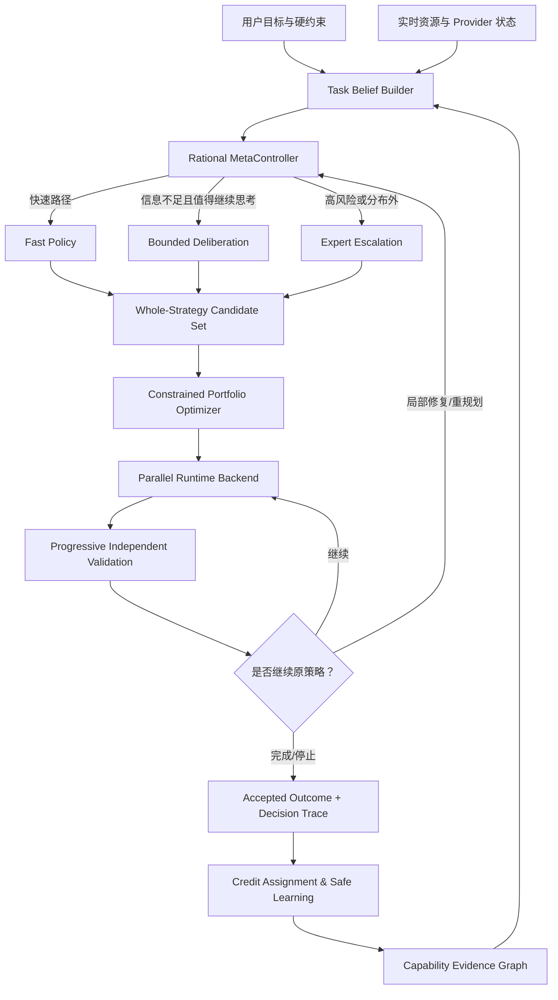

# CostWeave v0.6 决策智能架构

版本：Revision 2  
日期：2026-08-09

定位：本文件定义 CostWeave 如何从“带大量工程门禁的启发式控制面”升级为“可校准、会节制思考、能在执行中更新并安全学习的任务级决策系统”。它与 [`V0.6_COMPETITIVE_UPGRADE_PLAN.md`](V0.6_COMPETITIVE_UPGRADE_PLAN.md) 共同构成 v0.6 的正式路线。实际施工必须遵守 [`V0.6_LOW_CAPABILITY_MODEL_PLAYBOOK.md`](V0.6_LOW_CAPABILITY_MODEL_PLAYBOOK.md)，v0.6.0 的精确实现合同见 [`V0.6.0_IMPLEMENTATION_SPEC.md`](V0.6.0_IMPLEMENTATION_SPEC.md)。

## 1. 上一版计划为什么仍然不够智能

上一版计划已经解决公平评测、网关互操作和生产闭环，但核心决策过程仍容易落入以下顺序：

```text
理解任务 → 选择 Planner → 生成 DAG → 给每个节点选模型 → 执行 → 验收
```

这个顺序有六个根本缺陷：

1. **分解和模型选择相互影响**：某种分解只有在特定模型、工具和上下文成本下才划算，不能先分解再独立路由；
2. **单点预测会伪装确定性**：任务难度、模型成功率、价格和延迟都不是一个稳定分数，而是带证据等级的分布；
3. **MultiPlanner 仍可能浪费**：固定条件触发多个 Planner，没有计算新增意见真正能减少多少决策损失；
4. **执行反馈没有进入同一个决策状态**：半程验收后如果只是套恢复规则，不算真正动态决策；
5. **最终奖励难以归因**：一次任务成功或失败，不能直接归功或归咎于每个模型、提示词和 Planner；
6. **评测与学习可能分叉**：如果 Benchmark Router 和生产 Router 不是同一个入口，成绩不能代表线上行为。

因此，v0.6 的核心不再叫“更复杂的路由规则”，而叫 **Rational Metareasoning under Constraints**：在有限成本、时间、权限和不确定性下，决定应该思考多少、咨询谁、怎样执行，以及何时停止。

## 2. 竞争情报带来的新增要求

- [Router-R1](https://github.com/ulab-uiuc/Router-R1) 已把路由扩展到多轮选择和聚合；CostWeave 不能只做单次模型选择；
- [AgentOpt](https://github.com/AgentOptimizer/agentopt) 已把 Agent 多步骤模型组合视为组合搜索，并使用 Arm Elimination、LUCB 和 Bayesian 方法减少搜索成本；CostWeave 必须优化完整策略组合，而不只是单节点打分；
- [Microsoft Trace](https://github.com/microsoft/Trace) 已探索从执行轨迹传播通用反馈；CostWeave 必须解决任务级结果对 Planner、Router、Handoff、Executor 和 Validator 的分层信用分配；
- [LLMRouter](https://github.com/ulab-uiuc/LLMRouter) 已覆盖图路由、多轮、Agentic 和个性化路由；CostWeave 需要可插拔 Router，同时把优势放在任务级联合决策；
- [Magentic-One](https://github.com/microsoft/autogen/tree/main/python/packages/autogen-magentic-one) 使用任务与进度账本组织长任务；CostWeave 需要显式的动态信念与进度状态，而不只保存完成状态；
- 不确定性感知路由已经开始使用拒答、延迟决定和 Conformal 风险控制；CostWeave 的“升级”必须来自校准后的覆盖风险，而不是模型自报信心。

这些项目的公开性能数字仍只是各项目自己的结果。CostWeave 的设计必须能够独立复现、做消融并接受失败结论。

## 3. 总体架构



最高层不是固定的本地模型或云模型，而是一个策略控制器。模型只在需要语义理解、候选生成、批评或裁决时被调用。

## 4. 三类信念状态

### 4.1 Task Belief

系统不保存一个“难度 0.7”，而保存任务当前的结构化概率信念：

- 用户目标、成功契约和硬约束；
- 任务族与跨域组成概率；
- 可逆性、错误损失、权限和外部副作用；
- 所需工具、模态、上下文和知识新鲜度；
- 可分解性、可并行性、关键路径和耦合程度；
- 验收可观测性和 Judge 难度；
- 预期输入/输出 Token、资产大小和上下文搬运量；
- 认知不确定性：因为缺数据而不知道；
- 随机不确定性：即便知道也存在的输出波动；
- 分布外分数与可能的任务伪装，例如“改 CSS”实际涉及 WebGL、安全或数据迁移。

每项信念必须记录来源、时间、证据等级和校准版本。

### 4.2 Capability Evidence Graph

能力不是静态表格中的 `python=0.85`。建立异构证据图：

```text
Task family ──observed outcome── Model/Reasoning tier
     │                                │
Tool/Modality                    Provider deployment
     │                                │
Validator ──correlated failure── Model family
```

边保存条件化分布：

- 通过验收概率；
- 成本、首 Token 和完成时间分布；
- 重试、升级和返工概率；
- 与其他模型的失败相关性；
- 任务族、提示模板、工具和上下文条件；
- 数据量、时间衰减、版本漂移和置信区间。

新模型冷启动时使用厂商元数据、公开基准、模型族和邻近能力作为分层先验，但在获得本产品证据前保持宽置信区间。这样既不会把新模型永久排除，也不会把宣传资料当真实能力。

### 4.3 System Belief

- 本地 CPU/GPU、显存、队列、功耗和热状态；
- Provider 限流、排队、价格、缓存、错误和区域状态；
- 预算剩余、截止时间、并发槽和租户公平性；
- 已完成 Artifact、可复用上下文和污染范围；
- 遥测新鲜度与缺失程度。

本地高并发是否应立即求助云模型，来自 System Belief 的排队和完成时间分布，而不是等本地模型超时后再升级。

## 5. 决策空间：选择完整策略，而不是一个模型

一个候选动作是：

```text
Strategy = (
  management_mode,
  decomposition,
  model_and_reasoning_assignments,
  tool_assignments,
  context_and_handoff_plan,
  parallel_schedule,
  validation_plan,
  escalation_plan,
  recovery_plan,
  stop_conditions
)
```

其中 `management_mode` 只能是：

- `NO_DELEGATION`；
- `SINGLE_PLANNER`；
- `BOUNDED_MULTIPLANNER`；
- `EXPERT_ESCALATION`。

管理深度仍限制为两层。系统可以多次更新信念并重新决策，但不能递归创造第三层、第四层管理者。

## 6. 联合目标函数

系统不能只最小化 Token 价格，也不能只最大化自报成功率。对策略 `s` 计算：

```text
Utility(s) =
    E[Accepted Value]
  - λc · E[Total Monetary + Local Compute Cost]
  - λt · E[Time to Accepted Result]
  - λr · CVaRα(Failure Loss)
  - λo · Coordination Overhead
  - λe · Energy / Media Render Cost
```

同时满足硬约束：

```text
P(permission violation) = 0
P(budget overflow) ≤ ε_budget
P(deadline miss) ≤ ε_deadline
P(unaccepted result) ≤ ε_quality   # 只对高保证任务
data_residency ∈ allowed_regions
```

成本必须包含：

- MetaController、Planner 和 MultiPlanner；
- Prompt/Handoff 编译与上下文重复；
- 执行、工具、缓存、等待和本地算力；
- Validator、Judge 与人工检查；
- 重试、升级、返工和被取消的推测执行；
- 训练与探索成本按未来预期使用次数摊销。

对没有足够证据的尾部风险，使用保守上界而不是平均值。

## 7. Rational MetaController

### 7.1 两速控制

快速路径适用于：硬约束明确、风险低、历史相似度高、置信区间窄且直接动作与第二名动作差距足够大。

深思路径只在以下条件成立时启动：

```text
Expected Value of Computation
= 继续规划后减少错误决策损失的期望值
- 新增模型调用、延迟和协调成本
> 0
```

这直接回答“低智能模型尝试失败是否反而更贵”：如果便宜尝试的失败概率、返工损失和延迟使期望总成本高于直接调用强模型，就不允许便宜尝试。

### 7.2 Active Probe

当不确定性高但完整调用昂贵时，可以先执行一个可验证、低成本、无副作用的微型探针，例如：

- 要求候选模型生成接口 Schema，而不是完整实现；
- 对代码任务先定位根因与受影响文件；
- 对媒体任务先生成低清关键帧或 2 秒片段；
- 对超长上下文先做事实定位测试。

只有探针的期望信息价值大于成本时才执行；探针不得变成固定的“先低级模型试一次”。

### 7.3 自适应 Planner 委员会

MultiPlanner 不固定选择三个最强模型，而选择能提供最大边际信息且错误相关性较低的成员：

- 一个任务结构专家；
- 一个成本/资源专家；
- 高风险时增加安全或领域专家；
- 避免全部来自同一模型家族、相同提示或相同 Provider；
- 达到停止阈值后提前结束，不等待无增益成员；
- 分歧不是自动多数投票，而是触发冲突定位或可验证探针。

### 7.4 专家升级

出现下列情况时，快速控制器主动放弃决定权：

- OOD 或能力图证据过期；
- 高错误损失、不可逆副作用或安全边界；
- 最优候选的保守质量下界不达标；
- 前两名策略效用区间重叠且选择错误代价高；
- 任务解析产生互相不兼容的目标；
- 资源预测显示本地路径大概率错过截止时间。

## 8. Whole-Strategy Candidate Search

分解、模型、并发和验证需要联合搜索，但不能穷举。

### 8.1 候选生成

候选来源保持多样：

- 确定性模板和规则生成安全基线；
- 检索历史相似成功策略；
- 一个或多个 Planner 生成结构差异明显的方案；
- 对当前最佳方案做局部变换：合并/拆分节点、替换模型、改变验证器、调整并发；
- 保留 `NO_DELEGATION` 和强模型端到端作为永不缺席的基线。

### 8.2 有界 Anytime Search

使用分阶段搜索，而不是一次得到最终答案：

1. 硬约束剪枝；
2. 低成本代理模型快速淘汰明显劣势策略；
3. 保留质量—成本—时间 Pareto 集；
4. 对接近边界的候选进行蒙特卡洛或历史回放；
5. 仅对高价值不确定候选调用 Planner/Judge；
6. 任意时刻耗尽规划预算，都能返回当前最佳可行策略。

可插拔搜索器包括 Beam Search、Successive Halving、LUCB/Bayesian Selection 和约束组合优化；任何算法都必须经过同一 Tournament，而不是凭名称进入生产。

### 8.3 相关失败与组合价值

两个模型各自成功率高，不代表组合更好。如果它们在同类任务上同时犯错，第二意见价值很低。Capability Graph 必须估计失败相关性，并优先选择互补模型、工具或验证器。

## 9. Prompt、Context 与 Handoff Intelligence

模型衔接不是简单复制上一步文本。Handoff Compiler 生成：

- 不可更改的目标、权限、禁止动作和验收标准；
- 当前节点真正需要的最小事实切片；
- 输入 Artifact 引用与哈希，不重复搬运完整内容；
- 结构化输出 Schema、证据和不确定性字段；
- 假设、未知项和升级条件；
- 下游消费者及其兼容版本。

编译后执行四类检查：

1. **Coverage**：完成任务所需事实是否都存在；
2. **Contradiction**：目标、约束和依赖是否冲突；
3. **Authority**：是否扩大权限或工具范围；
4. **Information Loss**：压缩是否丢失会改变决策的内容。

对同一任务，Prompt/Handoff 是版本化策略资产；可以通过离线实验优化，但不能在线无门槛自我改写。

## 10. 执行中信念更新

每个节点返回的不只是输出，还包括可验证证据、实际成本/延迟、已使用假设、未解决风险和对下游的影响。

Progress Belief 记录：

- 当前成功概率分布及变化原因；
- 已验收与未验收 Artifact；
- 关键路径剩余时间；
- 剩余预算和容量；
- 哪些下游节点已被污染；
- 当前策略继续执行的预期效用；
- 改用其他策略的切换成本。

里程碑到达、模型结果异常、工具失败、预算偏差、Planner 假设被否定或资源状态变化时重新计算，而不是等待整个任务失败。

恢复动作统一比较：

- `CONTINUE`；
- `RETRY_NODE`；
- `SWITCH_MODEL`；
- `REQUEST_MISSING_INFO`；
- `REPLAN_SUBGRAPH`；
- `FULL_REPLAN`；
- `STOP_AND_RETURN_PARTIAL`。

已经发生的沉没成本不影响未来动作选择；可复用 Artifact、切换成本、污染范围和剩余预算会影响。

## 11. 独立验证与可观测成功

- 执行模型不能独立宣布最终成功；
- 机械验收、单元测试、Schema、事实引用等确定性证据优先于 LLM Judge；
- 必须使用 LLM Judge 时，记录与执行模型的家族相关性，并在高风险任务中使用异源 Judge 或人工门；
- 验收器本身也要有校准集、误报/漏报和版本；
- “系统察觉异常”与“系统采取正确恢复动作”分开计分；
- 输出正确但过程越权、超预算或丢失必要证据，仍判失败。

## 12. 分层信用分配

最终 Outcome 分解为：

```text
Goal Outcome
 ├─ decomposition contribution
 ├─ routing contribution
 ├─ prompt/handoff contribution
 ├─ executor/tool contribution
 ├─ validator contribution
 └─ recovery contribution
```

信用分配不能只靠一次 LLM 反思。优先级为：

1. 确定性验收和故障注入定位；
2. 可替换单节点的 Counterfactual Replay；
3. 匹配/分层模型估计；
4. 有记录选择概率时的 IPS/DR 离线策略评估；
5. 最后才是结构化 LLM 归因，且只作为低等级证据。

每次决策保存候选集、选择概率、拒绝原因和策略版本，为后续反事实学习保留条件。没有选择概率的历史数据不得伪装成无偏在线实验。

## 13. 安全自学习

系统的“自我学习”分为五步，而不是运行几次就修改规则：

1. 收集不可变 Decision Trace 和独立 Outcome；
2. 通过数据质量、泄漏、偏差、版本和证据门；
3. 训练或生成候选 Capability Posterior、Router、Prompt 或 Policy；
4. 离线盲测、压力测试、Shadow 和 Canary；
5. 达到预注册门后晋级，否则拒绝或回滚。

学习对象包括：

- 任务解析与 OOD 检测；
- 模型条件能力和失败相关性；
- 规划拓扑选择；
- Handoff/Prompt 策略；
- 验收器与恢复策略；
- 资源、队列、成本和截止时间预测。

生产策略不进行无约束在线梯度更新。探索由独立预算控制，只在安全、可回滚、低损失任务上进行。

## 14. 防止“为了智能而烧算力”的门禁

- 任何额外 Planner、Judge、Probe、并行副本和推测执行都必须通过信息价值或预期效用门；
- 规划预算同时限制金额、Token、时间和调用数；
- Context 去重、Artifact 引用和差量 Handoff 进入成本账本；
- 对候选策略使用 Early Elimination，不把所有方案执行到底；
- MultiPlanner 可以逐个追加成员并提前停止，不默认一次启动全部；
- 并发只缩短关键路径或提高可接受结果概率时启动；
- 本地模型过载时，准入层在第一次执行前比较排队完成分布与云端路径；
- 训练和 Benchmark 缓存按内容哈希复用，但不得跨租户或数据权限共享；
- 每个“智能模块”都必须做消融；没有增益的模块删除，而不是永久保留。

## 15. 必须新增的竞争测试

### 15.1 泛化

- 未见过的任务族；
- 新加入且只有少量样本的模型；
- 模型升级、降价和上下文扩展；
- 中文、英文及混合语言；
- 文本、代码、工具和多模态组合。

### 15.2 对抗与伪装

- 名称简单但真实风险高的任务；
- Prompt Injection、恶意工具返回和假证据；
- Provider 报告错误 Token/账单；
- 模型自报高信心但结果错误；
- Planner 共识但共同遗漏关键约束。

### 15.3 动态环境

- 本地队列突增；
- Provider 限流、宕机或价格突变；
- 截止时间缩短；
- 中途新增用户约束；
- 关键假设在半程被证伪。

### 15.4 消融

分别关闭：MetaController、Active Probe、Capability Graph、失败相关性、联合搜索、Progress Belief、独立 Validator、局部恢复和安全学习，测量每个模块对 CPS、成功率、P95 和额外开销的净贡献。

## 16. 五个最重要的智能指标

1. **Decision Regret**：与可获得证据下的事后最佳可行策略差距；
2. **Cost per Accepted Result**：所有规划、执行、验证和返工总成本除以验收成功数；
3. **Selective Risk-Coverage**：系统在多少任务上自行决策，以及这些决策的真实错误率；
4. **Value-of-Reasoning Realization**：额外思考实际减少的损失是否大于新增成本；
5. **Recovery Advantage**：动态恢复相对固定重试或全部重来的净收益。

辅助指标包括校准误差、Handoff Defect、无效并发、上下文重复率、Validator 误判、冷启动样本效率和策略漂移响应时间。

## 17. v0.6.0 必须先落地的合同

下一版先实现可验证的决策智能骨架，而不是直接训练大模型：

- `TaskBeliefV1`；
- `SystemBeliefV1`；
- `CapabilityPosteriorV1`；
- `StrategyCandidateV1`；
- `DecisionTraceV2`；
- `OutcomeCreditV1`；
- `MetaDecision`：快速、深思、探针或升级；
- `TournamentManifest`：数据、基线、价格、切分、随机种子和声明门；
- External Trace Import：允许 Claude 项目和其他竞品提交同格式决策；
- 决定性离线 Tournament 与消融骨架。

v0.6.0 不以“训练出更聪明的 Router”为退出条件，而以“后续任何智能算法都只能通过同一状态、动作、Trace 和 Tournament 进入系统”为退出条件。这能防止再次出现做了大量模块却无法证明哪一部分真正有效的问题。

## 18. 最终判断

CostWeave 不应把某个本地模型永久任命为总指挥，也不应永远使用最强模型指挥。合理结构是：

```text
低延迟确定性门禁
        +
校准后的本地快速策略
        +
按信息价值触发的有界 Planner/专家
        +
执行中持续更新的任务信念
```

它比“强模型总指挥一切”更节省，也比“本地模型先试错”更稳健。是否真的超过 Claude 项目或 GitHub 竞品，只能由统一 Tournament 和真实 Outcome 决定；但这套架构已经把竞争焦点从功能数量提升到了联合决策质量、元推理效率和安全学习能力。
