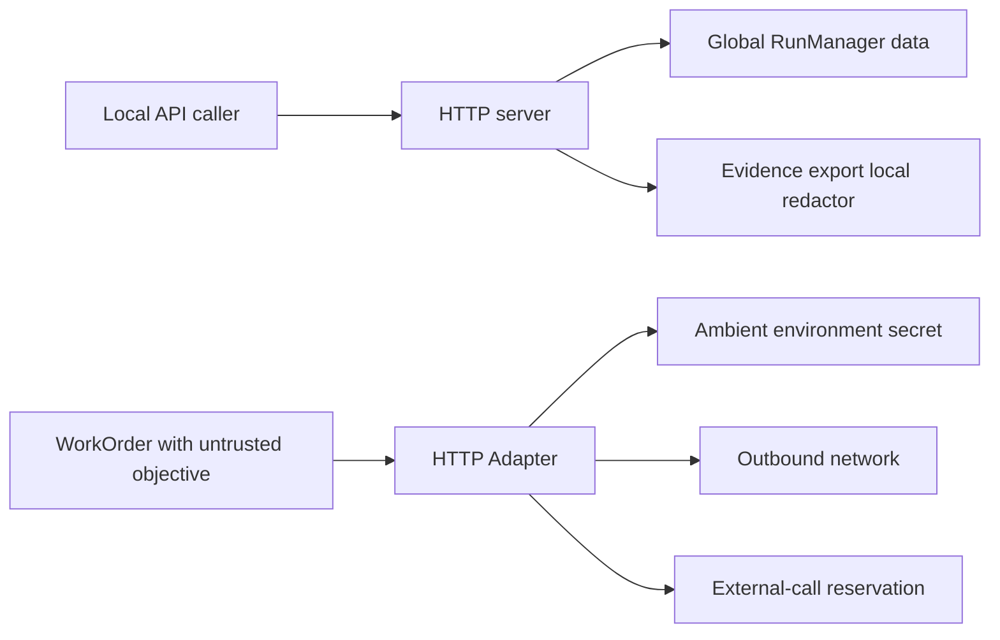
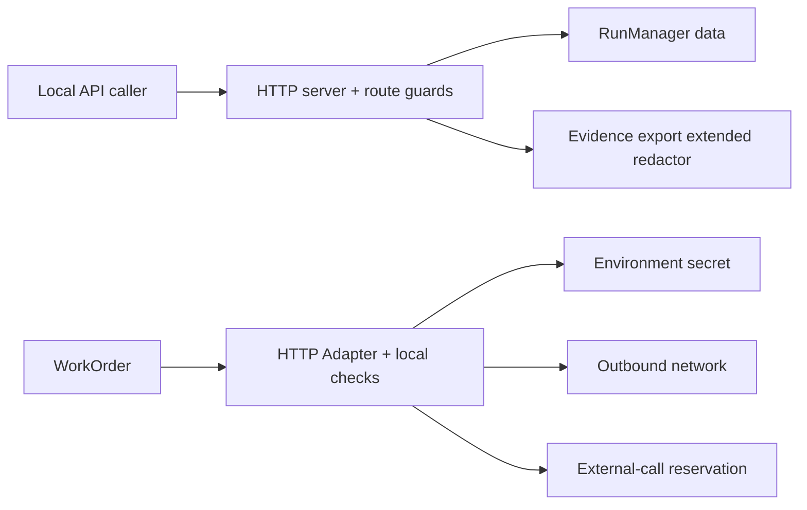
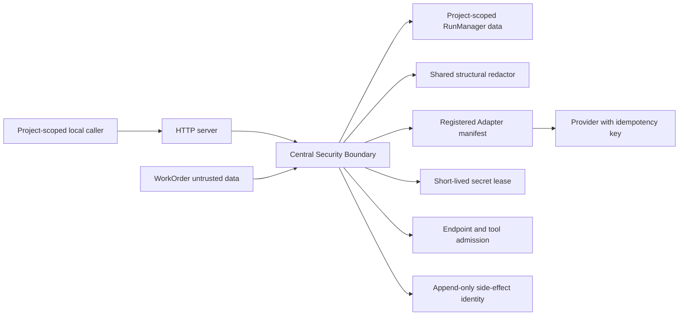
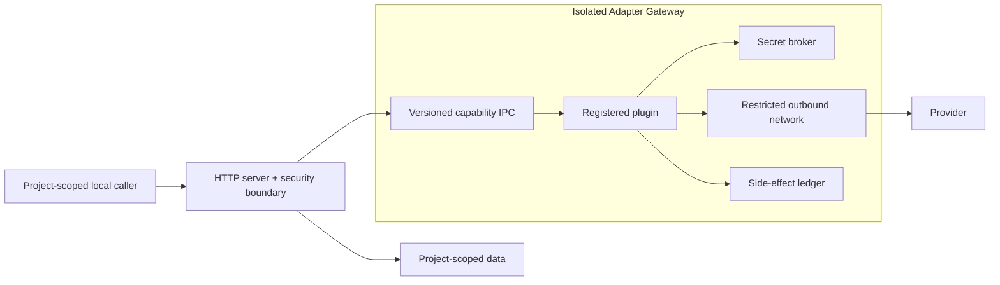

# Security Hardening Proposal: Centralize privileged Adapter and data-scope enforcement

## Decision

The v0.5.8.2 roadmap selects a central in-process security boundary, with a separate Adapter gateway deliberately deferred until production connectors justify process isolation.

## Executive Recommendation

We considered Option 1, **Strengthen local guards**; Option 2, **Central security boundary**; and Option 3, **Isolated Adapter gateway**. I recommend Option 2 under the current single-process, default-off constraints. It creates one control owner now and leaves a compatible seam for Option 3 later.

## Evidence

I inspected the current source owners directly. These observations most influenced the diagnosis:

| Evidence | Finding or document | What it establishes |
| --- | --- | --- |
| `E001` | Ambient Adapter secret and network authority | `costweave/adapters/http.py` reads configured environment values and constructs outbound requests inside the Adapter. |
| `E002` | External-call reservation and retry state | `costweave/experimental_calls.py` protects logical call identity, but Provider idempotency and a generic side-effect contract are not one durable invariant. |
| `E003` | Local export redaction rules | `costweave/evidence_console.py` has a useful but export-local redactor. |
| `E004` | Unscoped local HTTP surface | `costweave/server.py` protects loopback writes but returns global run-derived collections. |
| `E005` | Run request lacks security scope | `costweave/domain.py` has no durable project or residency field. |
| `E006` | Global RunManager collections | `costweave/engine.py` lists all in-memory runs and forwards global ledgers and approvals. |

Observed source does not prove a remotely exploitable deployment: the server is loopback-only and external Adapters are disabled by default. The inference is structural—if stable connectors and multiple projects are added without changing ownership, every new caller must remember the same dispersed rules.

## Current Design And Failure Mode

Today the HTTP server, exporter and Adapter each own a portion of the security story. That is reasonable for an offline prototype, but the boundary is defined by convention: the Adapter knows which environment variable to read, the exporter knows which keys look sensitive, and the HTTP handler assumes one local data scope. A future connector can be locally correct and still omit Provider idempotency, redirect rejection or project filtering.

The failure mode we want to prevent is not limited to one bug. It is control drift: a privileged call path reaches a credential, network sink or cross-project record without passing the same final policy decision. We should also be honest about the current containment limit: an in-process registry cannot safely host malicious plugin code.

## Desired Invariants

- Every privileged Adapter action is admitted against a versioned manifest.
- Only the secret broker reads secret environment variables; leases are short-lived and non-serializable.
- Endpoint, redirect, response-size, residency, prompt and tool rules pass before transport.
- Run ownership survives restart and every run-derived API checks it before lookup results are returned.
- A model sees untrusted objective data inside an explicit data envelope and cannot expand tools or authority.
- An external side effect has a project-scoped immutable identity; ambiguous completion is reconciled, never automatically repeated.
- Public JSON, logs, errors and evidence exports use one structural redactor.

## Constraints And Non-Goals

We preserve single-process operation, existing API defaults, SQLite, mock/local fixtures and zero external calls on a default install. We are not claiming sandboxed plugins, verified physical data erasure, malicious-model-proof prompting or production multi-tenant readiness.

## Before Architecture

The current diagram keeps the same abstraction level as the options: control ownership and privileged edges, not individual methods.

The risky property is the number of independent privileged edges. Loopback and default-off switches remain valuable tactical protections during migration.

## Options

### Option 1: Strengthen local guards

This option preserves every owner and adds project checks, broader redaction, endpoint validation and Provider idempotency directly where needed. Its strongest case is delivery speed: no new abstraction or storage vocabulary enters the critical path. It is also easy to reverse.

What gives us pause is recurrence. The next Adapter or export path can compile without invoking a guard because the security policy remains a set of conventions. The option addresses current paths but cannot make invalid future composition difficult.

| Change | Before | After | Security consequence | Cost |
| --- | --- | --- | --- | --- |
| Route filtering | None | Per-route checks | Current cross-project reads narrow | Audit every new route |
| Redaction | Export-local | Several enlarged local filters | More patterns covered | Rules can diverge |
| Side effects | Logical call reservation | Local Provider header | Duplicate risk narrows | Connector-specific work |

Option 1 is proportionate only if v0.5 stops adding connectors and data scopes. That is not the stated roadmap.

### Option 2: Central security boundary

This option gives one module ownership of Adapter manifests, endpoint admission, prompt assessment, secret leases, project identity, structural redaction and side-effect identity. Enforcement remains local to the operation, but every privileged path consumes the same representations. The existing external-call store remains the billing and retry owner; the new ledger records the broader side-effect invariant rather than duplicating it.

The central boundary adds bounded hashing, pattern matching and SQLite writes. We have not measured that overhead, so the release must benchmark it and report the result rather than calling it negligible. Reliability improves when crashes leave an ambiguous operation reserved instead of replaying it; the corresponding operational cost is a reconciliation state that users must be able to inspect.

| Change | Before | After | Security consequence | Cost |
| --- | --- | --- | --- | --- |
| Capability ownership | Adapter convention | Versioned manifest registry | Unknown plugins fail closed | Registry compatibility work |
| Secret access | Direct environment read | Short-lived broker lease | Values stay out of config and receipts | Broker lifecycle |
| Project scope | Implicit global local user | Durable RunRequest scope | Cross-project lookup fails as not found | Projection/API migration |
| Side-effect replay | Call-local reservation | Project identity + Provider key + append-only events | Ambiguous calls do not auto-repeat | Reconciliation state |
| Redaction | Export-local | Shared public-boundary redactor | Logs, errors and exports agree | Possible conservative masking |

The residual risk is clear: plugin Python code still shares the host process. Option 2 is a stable control plane, not a sandbox.

### Option 3: Isolated Adapter gateway

The strongest security design moves credentials and outbound sockets into a separate least-privileged process. The orchestrator would send a narrow capability request over a versioned protocol; a hostile connector could then crash its own process without reading the main runtime database.

That isolation is attractive, but today it would create a second runtime, queue, deployment unit, health model and upgrade protocol before any production Adapter traffic exists. The latency and memory effects are unknown. We can preserve Option 3 by keeping the in-process boundary protocol-shaped, then promote it when untrusted plugins or real credentials enter scope.

| Change | Before | After | Security consequence | Cost |
| --- | --- | --- | --- | --- |
| Process authority | Shared | Separate least-privileged gateway | Credential/network blast radius narrows | IPC and deployment complexity |
| Failure domain | Shared process | Connector process | Plugin crashes are isolated | Gateway availability dependency |
| Upgrade | One package | Versioned two-part rollout | Explicit compatibility | Operational burden |

Option 3 should win if CostWeave accepts third-party code, production secrets or policy-mandated workload isolation.

## Comparison

| Dimension | Option 1 | Option 2 | Option 3 |
| --- | --- | --- | --- |
| Security | Improves known paths; drift remains | Central fail-closed owner; in-process residual | Strongest authority isolation |
| Performance | Likely neutral; unmeasured | Bounded local overhead; benchmark required | IPC overhead; unknown |
| Memory | Bounded local values | Bounded registry/leases | Additional runtime and queues |
| Reliability | Early local rejection | Ambiguous replay containment and audit | Crash isolation plus gateway dependency |
| Operability | Lowest change | One policy/count surface and migration | Highest deployment burden |
| Migration | Smallest | Compatible projection/API changes | New protocol and dual-path rollout |

The important distinction is not a score; it is whether recurrence prevention now outweighs process isolation later. Under the roadmap, Option 2 is the balanced point.

## Recommendation

I recommend Option 2. We can preserve the default-off fast path while making stable connector admission and project scope explicit. We should switch to Option 3 before calling plugins untrusted or production-ready. If benchmarks show central admission P95 above 10 ms on local fixtures, we should optimize the store path before release rather than weakening the invariants.

## Evidence Coverage And Residual Risk

| Evidence | Effect under Option 2 | Tactical protection retained | Residual risk |
| --- | --- | --- | --- |
| E001 — Ambient Adapter authority | Addresses | External calls and paid calls remain separate switches | In-process plugin can still access Python globals |
| E002 — Retry state | Addresses | Existing call reservation remains authoritative | Provider may ignore its idempotency header |
| E003 — Local redaction | Addresses | Evidence manifest still states redaction boundary | Unknown secret formats can evade pattern detection |
| E004 — Unscoped API | Addresses | Loopback, Origin, Host and CSP checks remain | Local processes sharing project header have same authority |
| E005/E006 — Missing durable scope | Addresses | Old snapshots default to `local-default` | Logical deletion is not physical erasure |

## Migration And Rollout

Add defaulted project/residency fields so old projections hydrate unchanged. Apply one new migration for security events, tombstones and side-effect contracts. Keep external network switches off. Expose the policy and counts before any future Adapter activation. Rollback disables Adapter entry points and returns to v0.5.8.1 code; migration data remains inert.

## Validation Plan

- Seed a secret corpus and verify zero occurrences in public JSON, logs, errors, SQLite receipts and evidence exports.
- Reject tools, suspicious override prompts, remote private targets, redirects, oversized responses and disabled network before a fixture transport call.
- Create two projects and verify runs, tasks, artifacts, approvals and evidence cannot cross the boundary.
- Crash between reservation and completion and verify replay reports in-progress/ambiguous without a second transport call.
- Benchmark 10,000 pure admission checks and 1,000 store reservations; report P50/P95 and peak memory.
- Run all historical tests and old projection hydration.

## Implementation Work Packages

- Central contracts, registry, broker, redactor and project helpers.
- Append-only security store and migration 027.
- Adapter admission, bounded transport, prompt envelope and Provider idempotency.
- Durable RunRequest project scope and HTTP enforcement.
- Evidence/export and log redaction reuse.
- Security policy API, responsive status panel, tests and release documentation.

## Open Questions

- What future deployment requires verified physical deletion rather than logical access revocation?
- Which Provider idempotency semantics are trustworthy enough to avoid a compensation workflow?
- What measured overhead threshold should trigger an isolated or batched security ledger?
