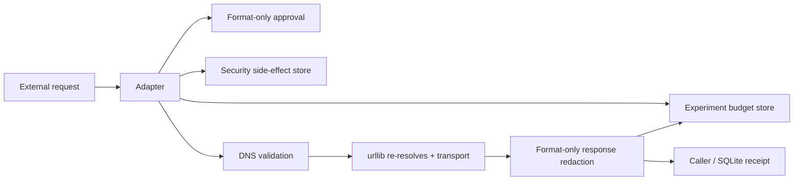
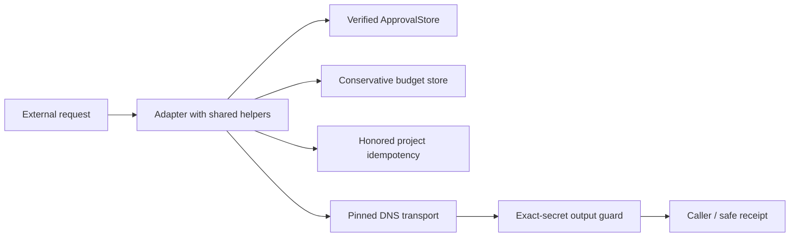
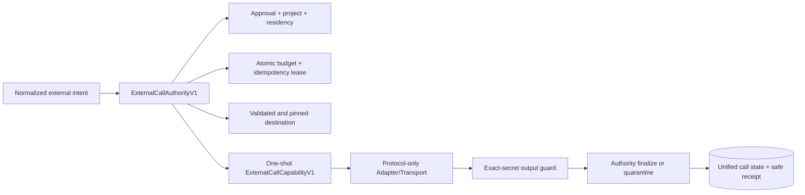

# Security Hardening Proposal: 单一外部调用授权能力

## Decision

我们需要决定是让每个 Provider Adapter 分别修复审批、秘密、DNS、预算和幂等问题，还是把“是否允许产生一次外部副作用”收敛为一个原子授权能力。

## Executive Recommendation

本方案比较两个选择：

- **Option 1：在现有 Adapter 与 Store 中逐点修复**，保留当前调用结构；
- **Option 2：建立 `ExternalCallAuthorityV1`**，由它在 transport 前签发一次性能力，并在 transport 后统一处理安全输出、账单和 ambiguous 状态。

我建议选择 Option 2。CostWeave 的核心价值就是经济控制；预算、审批和幂等如果由三套存储分别解释，真实 Provider 一接入就会反复出现账单与副作用状态不一致。不过，Provider 精确秘密回显和当前重放错误必须立即局部修复，不能等待 authority 迁移完成。

## Evidence

| Evidence | Finding | What it establishes |
|---|---|---|
| `F07` | `csf_afbe83962f948e1062ed4a46` — Provider 回显活跃秘密 | 输出清洗不知道当前租约秘密，返回与持久化边界失效 |
| `F08` | `csf_63792ed1c45566b8f9e22121` — 伪造 approval ID | 审批 gate 只验证字符串格式，没有权威状态和请求绑定 |
| `F09` | `csf_f987e97218460d8b9ec22e7e` — 失败释放预算 | 终态预算把未知账单当成零成本，硬预算不能覆盖真实账单 |
| `F10` | `csf_e0bd253ba41addebede73568` — 全局 replay 被忽略 | 实验内幂等和项目级副作用幂等拥有不同控制权 |
| `F11` | `csf_87708be056f6391c9a8e5923` — DNS-to-connect TOCTOU | 验证过的地址没有绑定实际 socket peer |

我检查了 `costweave/security_boundary.py:235-527`、`costweave/adapters/http.py:401-839`、`costweave/experimental_calls.py:251-580` 和 `costweave/security_store.py:174-240`。观察到审批、预算和副作用确实都有实现，但调用者可以丢弃其中一个判定；输出秘密和网络 peer 又在 transport 两侧分别处理。由此我们推断：当前缺少一个拥有完整外部调用生命周期的组件。

## Current Design And Failure Mode

现有 Adapter 依次调用多个边界：prompt assessment、格式型 approval、secret lease、实验预算 reserve、项目级 side-effect reserve、DNS validation、transport、response redaction、attempt/finalize。每一步单独看都有合理意图，但它们没有形成一个不可分割的状态机。

这种结构允许以下不一致：SecurityStore 返回 replayed，Adapter 却继续 transport；transport 已调用且账单未知，ExperimentalCallStore 却把 actual_cost=0 当终态；DNS 验证通过的地址被丢弃；SecretLease 的真实值只用于请求，不用于响应拒绝。真实 Provider 和重试越多，状态组合越难推断。

## Desired Invariants

- 只有权威、未过期、未撤销且绑定项目/请求/Provider/操作的审批才能授权风险 Prompt；
- 任何可能到达 Provider 的调用在对账前都占用保守预算；
- project + operation + idempotency key 对应最多一次外部副作用；
- ambiguous 不得自动重放，必须显式对账或补偿授权；
- 实际连接 peer 必须属于验证并固定的地址集合，代理策略必须显式；
- 当前活跃秘密及其受控编码形式不得出现在输出、Trace、回执、日志或数据库；
- 调用授权、transport attempt、结果、账单与关闭状态具有一条可恢复状态机；
- 默认外部和付费能力仍为空，不能仅凭环境变量意外开启。

## Constraints And Non-Goals

- 保持 Provider-neutral，不把 CostWeave 变成另一个 LiteLLM；
- v0.6.7 不接入真实付费 Provider，只使用 deterministic fixture 验证状态机；
- 不在同一事务中持有 SQLite 锁跨越网络请求；
- 不声称 authority 能知道 Provider 的最终账单，未知必须显式建模；
- 不把注入的 transport 当作安全边界，调用前后都要验证；
- 真实网络隔离 sidecar 留到生产需求明确后再决定。

## Before Architecture

[Mermaid 源文件](../diagrams/single-external-call-authority-before.mmd)

关键问题在于 Adapter 同时编排和执行安全决策。`B` 与 `I` 都返回状态，Adapter 可以错误解释或忽略；`D` 的结果没有进入 `T`；`AP` 和 `X` 又没有权威存储或当前秘密上下文。

## Options

### Option 1: Adapter 与 Store 逐点修复

该选择保留现有顺序：审批 gate 改为查询 ApprovalStore；Adapter 捕获 side-effect replay；失败 attempt 写入保守 actual cost；DNS 返回值传给一个 pinned transport；response redaction 增加 exact secret；每个 Adapter 使用共享测试套件。

它适合紧急发布，因为改动可以围绕已知 PoC 展开，不需要先设计新的能力协议。它也保留当前性能，没有额外序列化或 IPC。真正让我担心的是生命周期仍由 Adapter 手工拼接：新增流式 Adapter、缓存层或 Provider 特殊重试时，开发者仍必须记住所有状态转换。

[Option 1 after diagram](../diagrams/single-external-call-authority-local-fixes-after.mmd)

| Change | Before | After | Security consequence | Cost |
|---|---|---|---|---|
| 审批 | ID 正则 | 查询并绑定真实记录 | 关闭伪造 ID | 每次调用增加查询/缓存 |
| 预算 | unknown 终态为 0 | 保守冻结上界 | 硬预算覆盖 ambiguous | 可用预算更保守 |
| 幂等 | replay 值被忽略 | Adapter 显式分支 | 关闭当前跨实验重放 | 每 Adapter 需正确实现 |
| DNS | validate 后重解析 | 固定地址和 peer 校验 | 缩窄 SSRF | transport 实现更复杂 |
| 秘密 | 格式型正则 | exact lease value guard | 关闭当前回显 | 响应扫描开销 |

回滚可以逐修复回退，但不应回退安全不变量。若 Provider 兼容性受影响，应通过显式适配而不是恢复自动重放或不安全 DNS。

### Option 2: `ExternalCallAuthorityV1` 一次性能力

该选择把外部调用拆成两个清晰角色：Adapter 负责 Provider 协议转换，Authority 负责是否允许外部副作用。调用者提交规范化 intent；Authority 在一个本地事务边界内验证 RequestSecurityContext、真实审批、Provider/model scope、项目级幂等、最坏成本和秘密引用，返回一次性 `ExternalCallCapabilityV1`。

Capability 包含固定请求哈希、side_effect_id、budget lease、secret lease reference、已验证网络目的地和输出 guard。Transport 只能消费该 capability 一次。调用后，Authority 根据 confirmed-success、confirmed-failure 或 ambiguous 更新统一状态；无法确认账单时继续保留上界，直到 reconciliation 事件关闭。

该设计最有吸引力的部分是让 Adapter 无法忽略 replay 或绕过预算，因为没有 capability 就不能调用 transport。它也为 v0.7.1 的真实账单对账提供稳定状态机。代价是 authority 成为关键组件：其事务、lease 过期、崩溃恢复和并发必须认真设计；如果能力对象携带过多秘密，反而扩大暴露。因此 capability 只持有短期 scoped handle，不序列化秘密值。

[Option 2 after diagram](../diagrams/single-external-call-authority-capability-after.mmd)

| Change | Before | After | Security consequence | Cost |
|---|---|---|---|---|
| 安全所有权 | Adapter 组合多个判定 | Authority 原子签发能力 | 无授权无法 reach transport | 新状态机和 lease |
| 幂等/预算 | 两套状态分离 | 同一 capability 与 call state | replay 与账单状态一致 | 迁移 schema 和历史记录 |
| 网络 | URL 重新解析 | capability 绑定 destination | DNS 判定与 peer 一致 | 自定义 transport/peer 校验 |
| 秘密 | Adapter 可见并格式脱敏 | scoped handle + exact output guard | 减少持久和返回暴露 | 生命周期管理更严格 |
| 故障恢复 | failed/ambiguous 混合 | quarantine/reconcile 明确状态 | 禁止未知副作用自动重放 | 可用预算暂时冻结 |

我们可以先在进程内实现，不增加 IPC。若未来多租户或远端执行需要更强隔离，同一 capability 协议可以迁移到 sidecar；那时额外网络跳数和部署成本才有足够收益。

## Comparison

| Dimension | Option 1：局部修复 | Option 2：单一 Authority |
|---|---|---|
| Security | 修复已知路径；新 Adapter 仍可能组合错误 | 让外呼能力不可绕过，降低复发；source-derived，高置信 |
| Performance | 预期接近当前；需测 exact-secret 扫描和 DNS pinning | 增加一次 authority/lease 状态转换；进程内预期可控，未测 |
| Memory | 中性，少量 helper 状态 | 保留 capability、lease 和 quarantine 状态；需测高并发峰值 |
| Reliability | Provider 兼容性改动较局部 | 统一恢复更清晰，但 authority 故障会阻断所有外呼 |
| Operability | 每 Adapter 维护指标和错误 | 集中指标、拒绝原因、对账队列和 incident playbook |
| Migration | 最低，可快速关闭 PoC | 中高，可先包裹现有 Adapter 并双写/差分 |

性能判断均未测量。验证应使用当前 deterministic transport、批量并发 fixture 和故障注入，比较每秒准入、P50/P95 authority latency、SQLite lock wait、RSS、quarantine 数量和预算可用性。真实网络性能留到 v0.7.1，不在 v0.6.7 伪造。

## Recommendation

我推荐 Option 2，并把 Option 1 作为第一阶段战术修复。外部调用是 CostWeave 最危险也最有商业价值的能力；让它拥有一个可审计的 capability 边界，与项目定位一致，也能直接支撑后续真实对账。

如果 CostWeave 永久不执行外部调用，只输出 advisory 建议，那么 Option 1 足够，甚至可以删除大部分 paid-call 运行时代码。只要项目继续计划 v0.7.1 真实 Shadow，Authority 的迁移成本就是值得的。

## Evidence Coverage And Residual Risk

| Evidence | Option 1 | Option 2 | Tactical fix still required |
|---|---|---|---|
| `F07` — 活跃秘密回显 | addresses | addresses | 是，立即做 exact-value guard |
| `F08` — 伪造审批 | addresses | addresses 并绑定 capability | 是，接入真实 ApprovalStore |
| `F09` — ambiguous 预算释放 | addresses | addresses 并形成 quarantine | 是，立即保守计费 |
| `F10` — 全局 replay 被忽略 | addresses | addresses 并使 transport 不可达 | 是，立即处理 replay 分支 |
| `F11` — DNS-to-connect TOCTOU | addresses | addresses 并绑定能力目的地 | 是，需 pinned peer transport |

残余风险包括 Provider 自身不遵守幂等、账单延迟或错误、TLS/代理复杂性、流式输出跨分片秘密匹配、capability 泄漏和 reconciliation 人工错误。Authority 能让这些状态可见和失败关闭，但不能替 Provider 给出不存在的事实。

## Migration And Rollout

1. 先修复 exact secret、replay、保守预算和 DNS transport；
2. 定义 normalized intent、capability 和 call state，不启用真实网络；
3. 用 wrapper 让现有 Adapter 只能通过 Authority 获取 capability；
4. 双写旧 ExperimentalCallStore 与新状态，做确定性差分；
5. 将审批、预算、side-effect 和 secret lease 收敛到 Authority；
6. 关闭 Adapter 直接 reserve/transport 入口；
7. 运行故障矩阵、全量/隔离测试和安全复扫；
8. v0.7.1 才允许用户批准的真实小预算 Shadow。

回滚时可以让未迁移 Adapter 回到旧包装路径，但全局 paid/network 开关保持关闭；已经进入 ambiguous/quarantine 的调用不得通过回滚自动重试。

## Validation Plan

- 恶意 Provider 回显任意 opaque secret，所有输出和存储均不含秘密；
- fake approval、跨项目/过期/请求不匹配审批全部拒绝；
- transport timeout、429、503、malformed 2xx 保留预算上界；
- 跨实验相同 side-effect key 只产生一次 transport 调用；
- DNS 第一次公网、第二次私网的 fixture 不能连接私网；
- 并发 reserve/finalize 保持预算和幂等线性一致；
- authority 崩溃重启后 lease、ambiguous 和 receipt 可恢复；
- 全量、隔离、clean wheel 和标准安全扫描通过。

## Implementation Work Packages

- WP1：五条已知攻击路径的战术修复；
- WP2：外部 intent、capability 和状态机合同；
- WP3：权威审批与项目/地域绑定；
- WP4：预算、幂等和 reconciliation 合并；
- WP5：pinned destination 与 exact-secret output guard；
- WP6：Adapter wrapper、迁移、故障矩阵和安全复验。

## Open Questions

- ambiguous 预算冻结多久、由谁对账，超期如何关闭？
- Provider invoice 与本地 usage 冲突时哪个是权威，如何记录争议？
- 本地/远端端点是否允许显式代理；代理本身如何认证和 allowlist？
- 流式分片中的秘密需要多大跨分片窗口，如何控制内存？
- capability 是一次 attempt 还是一次 logical call；重试如何获得新 capability？
- 未来 sidecar 是否需要 OS sandbox 和独立秘密进程？
