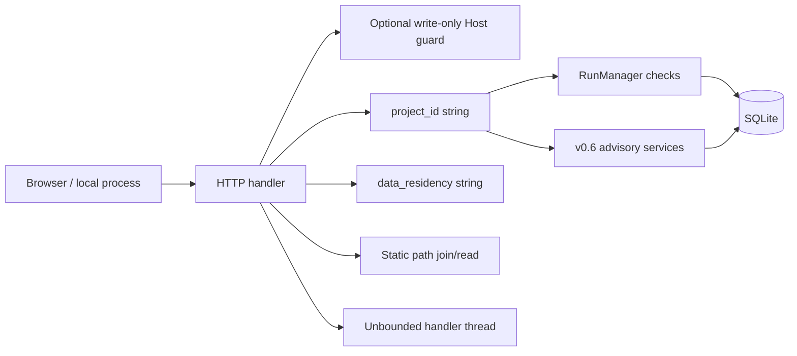
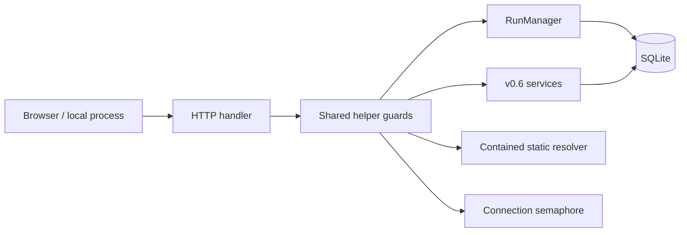
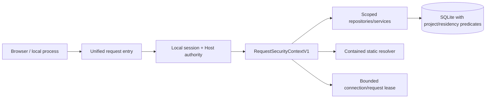

# Security Hardening Proposal: 统一入口安全上下文

## Decision

我们需要决定是继续在每条 HTTP 路由补充 Host、项目、地域和撤销检查，还是建立一个由入口和资源层共同拥有的、不可伪造的请求安全上下文。

## Executive Recommendation

本方案比较两个选择：

- **Option 1：加强现有路由局部 guard**，改动小、止血快，但安全规则仍由调用点负责；
- **Option 2：建立 `RequestSecurityContextV1` 与统一入口 guard**，先认证并解析最终资源范围，再让所有 store/service 只接受已验证上下文。

我建议选择 Option 2，同时把 Option 1 中的 Windows 路径、全方法 Host 校验和并发上限作为迁移前战术保护。CostWeave 仍是单进程原型，库内强类型边界足以显著降低控制漂移；当前没有必要立即引入独立鉴权服务。

## Evidence

| Evidence | Finding | What it establishes |
|---|---|---|
| `F01` | `csf_f0dc0afc4bbdc952e9418b59` — Windows 盘符路径越过静态目录 | 静态文件路径由 handler 自行过滤，缺少最终 resolved containment |
| `F02` | `csf_11aebc6fb58879228fdefb9b` — GET 缺少 Host 校验 | Host/Origin 控制只覆盖写请求，入口所有权不统一 |
| `F03` | `csf_0259e30cb2f655aafc1a87dc` — 项目头不是认证身份 | project_id 是调用方自报选择器，没有主体与所有权 |
| `F04` | `csf_b161cf81db311acca2687333` — 撤销未覆盖新服务 | v0.6 advisory/evidence 路由没有继承旧 Run 路径的 tombstone guard |
| `F05` | `csf_c45f21351f60228cb3040624` — 地域不参与授权 | data_residency 被记录但未进入权威资源读取条件 |
| `F06` | `csf_3216b2dff44d7f383d554b7c` — HTTP 活跃线程无上限 | 入口没有把并发作为需要授权和预算的资源 |

我检查了 `costweave/server.py:212-2529`、`costweave/server.py:2835-2860` 和 `costweave/engine.py:1952-1989`。观察到的事实是这些检查位于不同方法，且 `RunManager.get()` 只接收 project_id。由此我们推断：资源安全策略目前由调用点约定，而不是由资源边界要求。

## Current Design And Failure Mode

浏览器或本地进程可以直接提供 Host、项目和地域。handler 根据具体路由选择是否调用 `_validate_write_headers()`，再把普通字符串 project_id 交给 manager 或新服务。新模块只要遗漏一次 `ensure_project_active()`，撤销边界就失效；资源 API 没有 residency 参数时，入口即使解析地域也无法执行隔离。

静态文件和线程资源属于同一入口边界的两个旁支：前者根据字符串构造文件目标，后者根据连接直接分配线程。这些问题不需要共享同一个业务策略，但它们都说明“危险资源分配发生在最终安全上下文建立之前”。

## Desired Invariants

- 每个请求在路由前都验证允许的 Host 和本地会话身份；
- project_id 只能是认证主体被授权后的资源选择，不是身份本身；
- 项目撤销对所有旧、新、列表、详情、导出和动作端点立即生效；
- 若 data_residency 是安全边界，每个资源查询和动作都使用最终 residency；若不是，接口不得暗示隔离；
- 静态文件读取只能接受已证明位于 web 根内的 resolved path；
- 每个连接、请求和项目消耗的并发资源都有硬上限；
- 未建立完整安全上下文时，资源层失败关闭。

## Constraints And Non-Goals

- 保留当前 HTTP API 的主体形状，避免一次性破坏所有客户端；
- v0.6.7 不实现互联网公开监听、多租户计费或分布式鉴权；
- 不把项目头删除，但将其降为认证后的选择器；
- 不把目录全局性偷偷改成项目隔离，Catalog 的产品语义需另行决定；
- 迁移期旧 guard 继续存在，直到所有调用点完成差分验证。

## Before Architecture

[Mermaid 源文件](../diagrams/unified-request-security-context-before.mmd)

同一张图里最重要的边是 `H → P/R`：普通字符串在资源授权前没有被绑定到主体和最终资源。`W` 只出现在写路径，`NEW` 又绕开旧 manager 的撤销逻辑。静态文件和线程资源也在统一入口判定之外。

## Options

### Option 1: 加强现有路由局部 guard

我们可以先为所有 GET/POST/静态路径调用统一 helper，在每个新服务前补 `ensure_project_active()`，把 residency 参数逐个加入 manager/store，并为服务器增加 semaphore。这个选择最吸引人的地方是改动边界小，原 PoC 能很快变成回归测试；如果 v0.6.7 只允许极少代码预算，它是现实的止血方案。

但它保留了根本问题：下一条服务仍可以忘记 helper，资源方法仍可能接受未经验证的字符串。代码审查和测试矩阵成为唯一防线，`server.py` 已接近 3,000 行时，这种所有权很容易再次漂移。

[Option 1 after diagram](../diagrams/unified-request-security-context-local-guards-after.mmd)

| Change | Before | After | Security consequence | Cost |
|---|---|---|---|---|
| Host guard | 只覆盖写路径 | 每条方法显式调用 shared helper | 关闭当前 GET rebinding 路径 | 需长期维持路由覆盖表 |
| 项目/撤销 | 部分 manager 内检查 | 每条服务前补检查 | 修复当前遗漏 | 新服务仍可能忘记 |
| 地域 | 仅记录 | 逐 API 增加参数 | 可实现当前资源隔离 | 签名和迁移工作分散 |
| 静态文件 | 字符串过滤 | resolved containment | 关闭盘符越界 | 很小的路径计算开销 |
| 并发 | 线程无限增长 | semaphore | 有界本地 DoS | 超限请求会快速失败 |

回滚很直接：逐个撤销 helper 调用。但安全补丁一旦上线，不应为了兼容重新开放已知攻击路径；真正可回滚的是迁移方式，不是安全不变量。

### Option 2: `RequestSecurityContextV1` 与统一入口 guard

该选择在 HTTP 入口一次性验证 Host、本地会话和请求形状，再通过一个 authority 建立不可变上下文：principal、project ownership、project active、residency、operation scope 和 request identity。manager/store 不再接收裸 project_id 执行受保护操作，而接收 `RequestSecurityContextV1` 或由它派生的 scoped handle。

它的强点不是“多一个类”，而是让缺失检查在类型和 API 层变得难以表达。新 v0.6 服务若没有上下文，就无法调用项目型 store。静态 resolver 和并发 lease 也由入口返回受限能力，而不是让 handler 自行分配危险资源。

我们应当诚实面对迁移成本：旧测试和内部调用大量传递字符串，需要兼容 adapter；上下文创建可能增加一次数据库读取或缓存查找；如果缓存 tombstone，必须定义失效语义。好处是这些成本都位于一个可测量的 choke point，而不是分散到每个路由。

[Option 2 after diagram](../diagrams/unified-request-security-context-owned-boundary-after.mmd)

| Change | Before | After | Security consequence | Cost |
|---|---|---|---|---|
| 调用身份 | 自报 project header | 认证 principal + authorized selector | 跨本机进程项目访问被拒绝 | 本地令牌生命周期与存储 |
| 安全所有权 | handler/manager/service 分散 | 单一 authority 建立上下文 | 新服务默认继承撤销/地域 | 需要兼容 adapter 迁移 |
| Store API | 裸 project_id | scoped context/handle | 缺失授权难以表达 | 类型和测试变化较多 |
| 墓碑 | 调用点查询 | authority + store 双层失败关闭 | 减少遗漏和竞态 | 缓存失效需设计 |
| 资源分配 | 读取前自行决定 | 入口签发文件/并发能力 | 危险能力范围收窄 | 轻微对象和锁开销 |

该方案可按服务迁移：先让上下文与旧参数并存并做差分，再将旧入口标记 deprecated，最后删除。若新上下文出现可靠性问题，feature flag 可以让尚未迁移的服务退回旧 baseline，但已知 Host、路径和认证保护继续保持。

## Comparison

| Dimension | Option 1：局部 guard | Option 2：统一安全上下文 |
|---|---|---|
| Security | 当前路径改善，未来漂移仍高；source-derived，高置信 | 当前路径与未来调用所有权同时改善；source-derived，高置信 |
| Performance | 预期中性；需测每路由 guard P95 | 可能增加一次上下文建立/缓存；需测 API P50/P95 |
| Memory | 中性，仅少量 helper 状态 | 少量不可变上下文和缓存；需测高并发 RSS |
| Reliability | 局部失败易定位，但规则不一致 | 统一失败语义更可靠；authority 故障影响面更大 |
| Operability | 继续维护路由矩阵 | 增加认证令牌、context 指标和拒绝原因观测 |
| Migration | 最低，适合紧急补丁 | 中等，可逐服务双轨迁移并回滚 |

这些判断不是性能实测。v0.6.7 应使用当前 1011 项基线、典型 GET/POST 工作负载和并发连接场景，记录 P50/P95、CPU、RSS、拒绝率和 tombstone 生效延迟。若统一上下文使本地 API P95 超过预注册预算，应先优化缓存和查询，而不是退回不安全的字符串授权。

## Recommendation

在当前约束下，我推荐 Option 2。CostWeave 正准备把五个 advisory 服务接入主链，正是统一安全上下文最有价值的时间点；继续补路由会把同一风险带入 v0.6.9。Option 1 中的直接修复仍然必须立即实施，作为迁移期间的保护。

如果项目决定永久保持单一可信 OS 用户、完全不提供 HTTP 给其他本地进程，并删除 project/residency 的安全承诺，Option 1 可能足够。但这会收缩产品目标，必须在 README 和 API 中明确，而不能保留多项目/地域外观却不执行边界。

## Evidence Coverage And Residual Risk

| Evidence | Option 1 | Option 2 | Tactical fix still required |
|---|---|---|---|
| `F01` — Windows 静态越界 | addresses | addresses | 是，立即做 resolved containment |
| `F02` — GET Host 缺失 | addresses | addresses | 是，统一 guard 上线前即修 |
| `F03` — 无认证项目头 | mitigates | addresses | 是，先引入高熵本地令牌 |
| `F04` — 撤销遗漏 | addresses 当前路由 | addresses 并降低复发 | 是，补当前服务检查 |
| `F05` — 地域未授权 | addresses | addresses | 是，先决定地域是否安全边界 |
| `F06` — 无界线程 | addresses | addresses | 是，增加硬并发上限 |

残余风险包括本地令牌文件权限、上下文缓存失效、TOCTOU 的资源身份变化以及未迁移插件直接调用 store。迁移完成后仍需搜索并禁止裸 store 访问。

## Migration And Rollout

1. 先合入 Host、路径、当前撤销遗漏和并发上限的战术补丁；
2. 定义上下文与 authority，不改变路由结果；
3. 为旧参数建立兼容 adapter，记录新旧授权差异；
4. 依次迁移 evidence、MetaController、Capability、JointSearch、Recovery、SafeLearning；
5. 迁移 Run/Task/Artifact 核心路径；
6. 关闭裸 project_id 入口并加入静态检查；
7. 重新运行原 PoC、全量/隔离测试和安全扫描。

每一步都可以回退到上一已迁移集合；数据库 schema 采用向前兼容字段和索引，不在同一发布删除旧列。

## Validation Plan

- 重放 Windows 盘符、非回环 Host、撤销后读取、跨地域读取和未认证项目访问；
- 对所有 HTTP method、API 前缀和静态路径生成授权矩阵；
- property test：任何 project-scoped store 调用都必须持有 context；
- 并发压力记录线程数、RSS、超限行为和恢复时间；
- 比较旧/new context 的授权结果，差异必须有预注册原因；
- 全量、隔离、clean wheel、浏览器和标准安全扫描通过。

## Implementation Work Packages

- WP1：战术入口补丁与原 PoC 回归；
- WP2：本地会话和 `RequestSecurityContextV1` 合同；
- WP3：scoped store/service adapter；
- WP4：advisory 服务迁移；
- WP5：核心 Run 资源迁移；
- WP6：并发、性能、回滚和安全复验。

## Open Questions

- 本地认证优先使用 bearer 文件令牌还是 OS 用户绑定 transport？
- data_residency 是强安全边界还是展示标签？
- tombstone 是否允许短 TTL 缓存；最大生效延迟是多少？
- Catalog 是否保持全局，还是未来纳入项目上下文？
- 第三方插件如何获得 scoped handle，而不是直接访问 SQLite store？
